# ambientCG: More materials

**35 assets from [ambientCG](https://ambientcg.com), dedicated to the public domain under [CC0](https://docs.ambientcg.com/license/).** Use them in any game, free or paid, and change them however you like; no credit is needed.

PBR materials as 1K and 2K JPG maps (colour, normal GL and DX, roughness, AO, displacement), one folder per resolution. 895.1 MB in all.

This is a copy kept by [zuujis-cc0](https://github.com/zuujis-cc0) so game makers can take single files from GitHub. It is not made by or affiliated with ambientCG: the originals, often in more formats and higher resolutions, are on [ambientcg.com](https://ambientcg.com). If they help you, consider [supporting ambientCG](https://www.patreon.com/ambientCG).

Every file is listed in [MANIFEST.tsv](MANIFEST.tsv) with its size and SHA-256. More free assets: [the Zuujis collection](https://github.com/zuujis-cc0/free-game-assets#readme).

| | | | |
| :-: | :-: | :-: | :-: |
| <a href="Tatami002">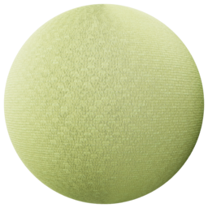</a> <b><a href="Tatami002">Tatami 002</a></b> by ambientCG · <a href="https://ambientcg.com/a/Tatami002">source</a> | <a href="Tatami003">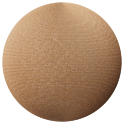</a> <b><a href="Tatami003">Tatami 003</a></b> by ambientCG · <a href="https://ambientcg.com/a/Tatami003">source</a> |  <b><a href="Tatami004">Tatami 004</a></b> by ambientCG · <a href="https://ambientcg.com/a/Tatami004">source</a> | <a href="Tatami005">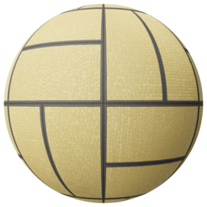</a> <b><a href="Tatami005">Tatami 005</a></b> by ambientCG · <a href="https://ambientcg.com/a/Tatami005">source</a> |
| <a href="Tatami006">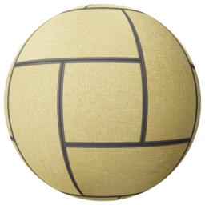</a> <b><a href="Tatami006">Tatami 006</a></b> by ambientCG · <a href="https://ambientcg.com/a/Tatami006">source</a> | <a href="ThatchedRoof001A">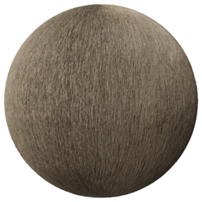</a> <b><a href="ThatchedRoof001A">Thatched Roof 001 A</a></b> by ambientCG · <a href="https://ambientcg.com/a/ThatchedRoof001A">source</a> | <a href="ThatchedRoof001B">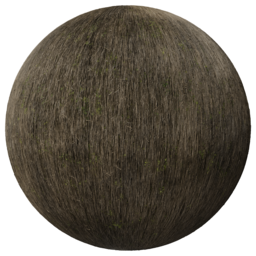</a> <b><a href="ThatchedRoof001B">Thatched Roof 001 B</a></b> by ambientCG · <a href="https://ambientcg.com/a/ThatchedRoof001B">source</a> | <a href="ThatchedRoof002A">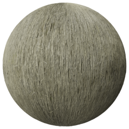</a> <b><a href="ThatchedRoof002A">Thatched Roof 002 A</a></b> by ambientCG · <a href="https://ambientcg.com/a/ThatchedRoof002A">source</a> |
| <a href="ThatchedRoof002B">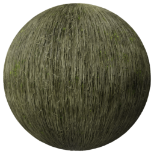</a> <b><a href="ThatchedRoof002B">Thatched Roof 002 B</a></b> by ambientCG · <a href="https://ambientcg.com/a/ThatchedRoof002B">source</a> | <a href="Travertine001">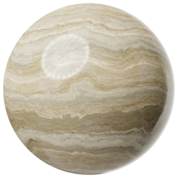</a> <b><a href="Travertine001">Travertine 001</a></b> by ambientCG · <a href="https://ambientcg.com/a/Travertine001">source</a> | <a href="Travertine002">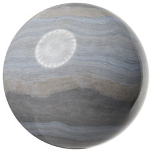</a> <b><a href="Travertine002">Travertine 002</a></b> by ambientCG · <a href="https://ambientcg.com/a/Travertine002">source</a> | <a href="Travertine003">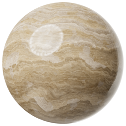</a> <b><a href="Travertine003">Travertine 003</a></b> by ambientCG · <a href="https://ambientcg.com/a/Travertine003">source</a> |
| <a href="Travertine004">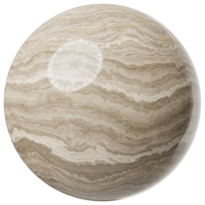</a> <b><a href="Travertine004">Travertine 004</a></b> by ambientCG · <a href="https://ambientcg.com/a/Travertine004">source</a> | <a href="Travertine005">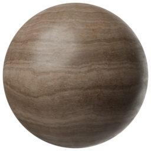</a> <b><a href="Travertine005">Travertine 005</a></b> by ambientCG · <a href="https://ambientcg.com/a/Travertine005">source</a> | <a href="Travertine006">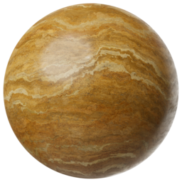</a> <b><a href="Travertine006">Travertine 006</a></b> by ambientCG · <a href="https://ambientcg.com/a/Travertine006">source</a> | <a href="Travertine007">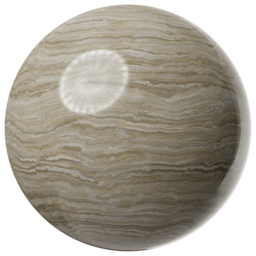</a> <b><a href="Travertine007">Travertine 007</a></b> by ambientCG · <a href="https://ambientcg.com/a/Travertine007">source</a> |
| <a href="Travertine008">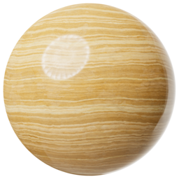</a> <b><a href="Travertine008">Travertine 008</a></b> by ambientCG · <a href="https://ambientcg.com/a/Travertine008">source</a> | <a href="Travertine009">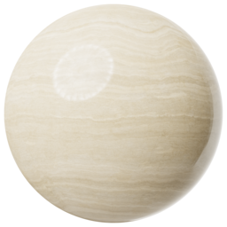</a> <b><a href="Travertine009">Travertine 009</a></b> by ambientCG · <a href="https://ambientcg.com/a/Travertine009">source</a> | <a href="Travertine010">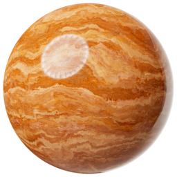</a> <b><a href="Travertine010">Travertine 010</a></b> by ambientCG · <a href="https://ambientcg.com/a/Travertine010">source</a> | <a href="Travertine011">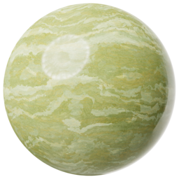</a> <b><a href="Travertine011">Travertine 011</a></b> by ambientCG · <a href="https://ambientcg.com/a/Travertine011">source</a> |
| <a href="Travertine012">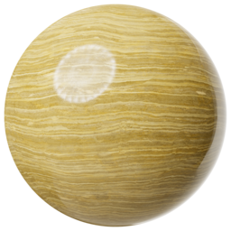</a> <b><a href="Travertine012">Travertine 012</a></b> by ambientCG · <a href="https://ambientcg.com/a/Travertine012">source</a> | <a href="Travertine013">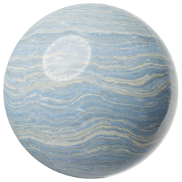</a> <b><a href="Travertine013">Travertine 013</a></b> by ambientCG · <a href="https://ambientcg.com/a/Travertine013">source</a> | <a href="Travertine014">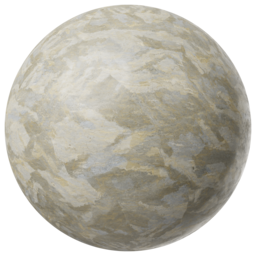</a> <b><a href="Travertine014">Travertine 014</a></b> by ambientCG · <a href="https://ambientcg.com/a/Travertine014">source</a> | <a href="TreeEnd001">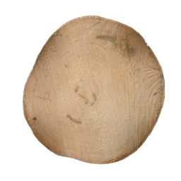</a> <b><a href="TreeEnd001">Tree End 001</a></b> by ambientCG · <a href="https://ambientcg.com/a/TreeEnd001">source</a> |
| <a href="TreeEnd002">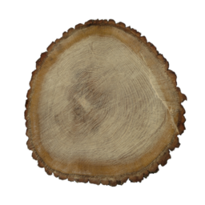</a> <b><a href="TreeEnd002">Tree End 002</a></b> by ambientCG · <a href="https://ambientcg.com/a/TreeEnd002">source</a> | <a href="TreeEnd003">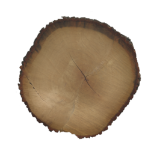</a> <b><a href="TreeEnd003">Tree End 003</a></b> by ambientCG · <a href="https://ambientcg.com/a/TreeEnd003">source</a> | <a href="TreeEnd004">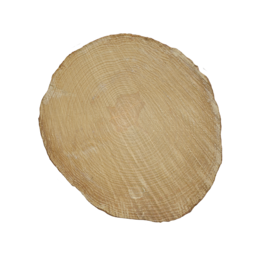</a> <b><a href="TreeEnd004">Tree End 004</a></b> by ambientCG · <a href="https://ambientcg.com/a/TreeEnd004">source</a> | <a href="TreeEnd005">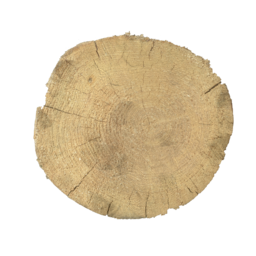</a> <b><a href="TreeEnd005">Tree End 005</a></b> by ambientCG · <a href="https://ambientcg.com/a/TreeEnd005">source</a> |
| <a href="Wallpaper001A">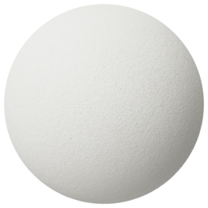</a> <b><a href="Wallpaper001A">Wallpaper 001 A</a></b> by ambientCG · <a href="https://ambientcg.com/a/Wallpaper001A">source</a> | <a href="Wallpaper001B">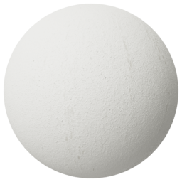</a> <b><a href="Wallpaper001B">Wallpaper 001 B</a></b> by ambientCG · <a href="https://ambientcg.com/a/Wallpaper001B">source</a> | <a href="Wallpaper001C">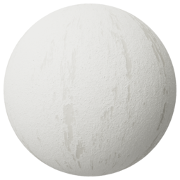</a> <b><a href="Wallpaper001C">Wallpaper 001 C</a></b> by ambientCG · <a href="https://ambientcg.com/a/Wallpaper001C">source</a> | <a href="Wallpaper002A">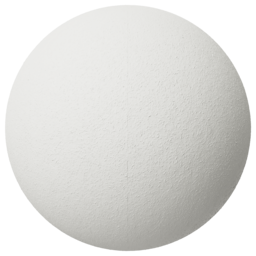</a> <b><a href="Wallpaper002A">Wallpaper 002 A</a></b> by ambientCG · <a href="https://ambientcg.com/a/Wallpaper002A">source</a> |
| <a href="Wallpaper002B">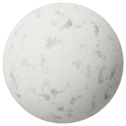</a> <b><a href="Wallpaper002B">Wallpaper 002 B</a></b> by ambientCG · <a href="https://ambientcg.com/a/Wallpaper002B">source</a> | <a href="Wallpaper002C">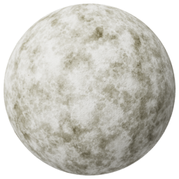</a> <b><a href="Wallpaper002C">Wallpaper 002 C</a></b> by ambientCG · <a href="https://ambientcg.com/a/Wallpaper002C">source</a> | <a href="WoodChips001">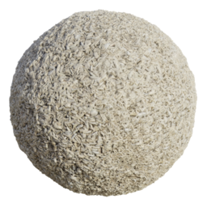</a> <b><a href="WoodChips001">Wood Chips 001</a></b> by ambientCG · <a href="https://ambientcg.com/a/WoodChips001">source</a> |  |

---

Kept up to date by this repository's own [update workflow](.github/workflows/update.yml), with code and plan from [cc0-mirror](https://github.com/zuujis-cc0/cc0-mirror). Something wrong? [Open an issue there](https://github.com/zuujis-cc0/cc0-mirror/issues/new) or use the [private report form](https://games.zuujis.com/report).
